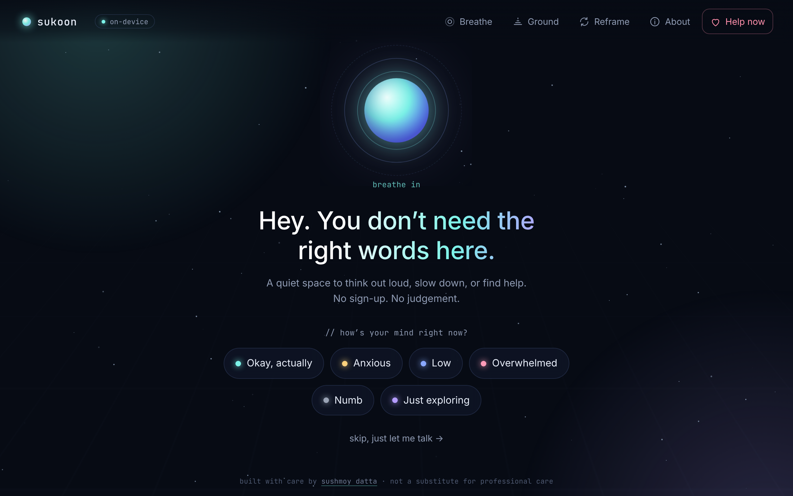
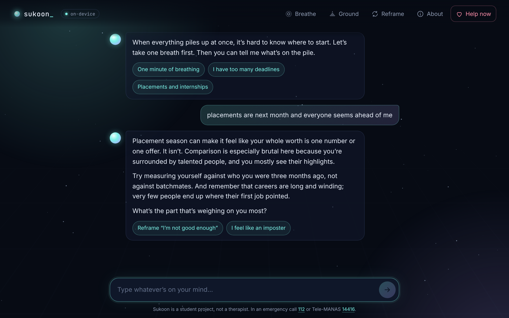
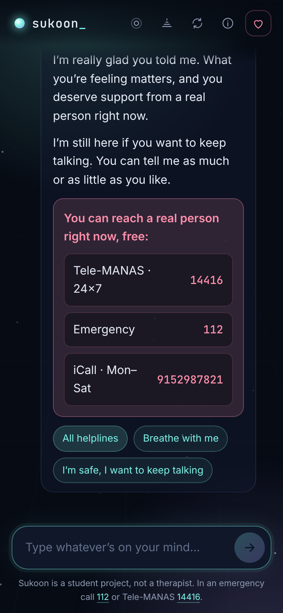

# Sukoon · IIT ISM Student Wellbeing Assistant

**[▶ Live demo](https://sushmoydatta.github.io/IIT-ISM-Student-Wellbeing-Assistant/)** · runs entirely in your browser, nothing you type leaves your device.

A crisis-aware wellbeing companion for students at IIT (ISM) Dhanbad. Every message goes through a safety triage layer first. Risky messages skip the AI entirely and get a person-first response with real helplines. Everything else gets a calm, grounded reply drawn from campus wellbeing resources.

*Sukoon* (सुकून) means peace of mind.



| Conversation | Safety response (mobile) |
|---|---|
|  |  |

## What's in it

- **Crisis triage.** Severity-weighted pattern rules across five categories (suicide, self-harm, immediate danger, distress, abuse/ragging). They run on-device before anything else, so a safety response never depends on the network.
- **Grounded answers.** The backend chunks campus documents, embeds them with `all-MiniLM-L6-v2`, retrieves the top-k chunks above a similarity threshold, and asks Llama 4 (via Groq) to answer with a safety-aware system prompt.
- **Body-first tools.**
  - Guided 4-in/6-out breathing, synced to a breathing orb.
  - 5-4-3-2-1 sensory grounding.
  - A CBT-style thought-reframe journal, stored only in the browser.
- **Privacy by default.** Logs record metadata only. Message text is redacted unless explicitly enabled, and session IDs are hashed.

## Design philosophy

The UI follows the product's goal: reduce the friction of asking for help.

| Principle | How it shows up |
|---|---|
| Low barrier | No sign-up. A mood check-in replaces the intimidating blank text box. |
| Regulate before reasoning | The landing orb breathes at a calming 4s-in/6s-out pace before you type anything. |
| Validate, then help | Replies reflect the feeling first, normalise it, then offer one small step (person-centred counselling). |
| Autonomy | Suggested replies and tools are offered, never forced. "Skip, just let me talk" is always there. |
| Honest about limits | The bot always points to humans and states that it isn't a therapist. "Help now" is always one tap away. |
| Calm futurism | Dark, soft neon used as light rather than alarm, slow motion, and full `prefers-reduced-motion` support. |

## Architecture

```
Browser (frontend/)                         FastAPI (backend/)
───────────────────                         ──────────────────
message ─► on-device triage ─┬─ crisis ─► safety card + helplines
                             │
                             └─ ok ─► demo: curated companion replies
                                      live: POST /chat ─► triage again
                                                         ─► MiniLM top-k retrieval
                                                         ─► Llama 4 (Groq)
                                                         ─► privacy-first log
```

The frontend runs in **demo mode** by default, which is how it's hosted on GitHub Pages. Point it at a running backend to switch to **live mode**: set `API_URL` in `frontend/js/config.js`, or open the page with `?api=https://your-backend/chat`. If the backend is unreachable, the page falls back to on-device replies.

## Run locally

```bash
cd backend
pip install -r requirements.txt
cp .env.example .env   # add your GROQ_API_KEY
uvicorn main:app --reload
```

```bash
cd frontend
python -m http.server 5500
```

Then open `http://localhost:5500/?api=http://127.0.0.1:8000/chat`.

Tests:

```bash
cd backend && pip install -r requirements-dev.txt && pytest -q
```

## Project structure

```
backend/
  main.py          FastAPI app: /chat, health check, CORS
  crisis.py        Pattern-based triage + safety responses
  doc_engine.py    Chunking, embeddings, retrieval, Groq call
  logger.py        Redacted CSV logs + daily analytics
  models.py        Pydantic schemas
  data/            Campus wellbeing documents (RAG corpus)
  tests/           pytest suite for triage and API
frontend/
  index.html, css/style.css
  js/triage.js     Client-side port of crisis.py
  js/companion.js  On-device replies for demo mode
  js/app.js        UI, chat, breathing/grounding/reframe tools
.github/workflows/ Pages deploy + backend tests
```

## Honest limitations

This is a learning prototype, not a deployed or clinically validated system.

- **Crisis detection is still pattern-based.** Whole-word matching and common variants reduce false positives (e.g. "cutting-edge"), but indirect language like "I won't be a problem much longer" can be missed. A real deployment needs a trained classifier and human review.
- **Demo mode replies are curated, not generated.** They're written to be safe and supportive, but they don't understand context the way the live LLM pipeline does.
- **No human escalation.** A production system would need a path to alert an on-call counsellor.
- **Campus details.** Helplines are national services (Tele-MANAS, iCall, 112, anti-ragging). For IIT ISM counselling the bot points to the institute website instead of hard-coding contacts that could go stale.

## What I'd do next

- Replace pattern triage with a fine-tuned classifier, evaluated on recall for high-risk messages
- Evaluate retrieval quality properly (labelled queries, recall@k)
- Add an opt-in counsellor hand-off flow
- Add Hindi and Bengali support

## License

MIT
